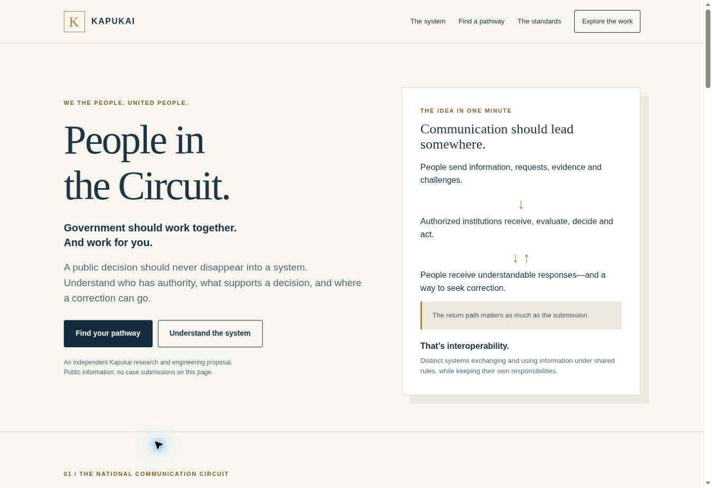

# People in the Circuit — verified review release

**Status: implemented and verified on Vercel; branded installation remains pending.**

Tested source: `71a6d6f4345e73b30267b617a2f4043d04a6d0f4`.

- [Exact Vercel deployment](https://kapukai-circuit-preview-k9mc5l073-kapukais-projects.vercel.app/circuit/) (Vercel authentication or a current share link may be required).
- [Successful test run](https://github.com/Kapukai/kapukai-governance-site/actions/runs/44723330857).
- [Existing PR #35](https://github.com/Kapukai/kapukai-governance-site/pull/35).

## What is implemented

The selected ivory/navy/gold prototype is restored, preserving its two-column
introduction, complete communication diagram, five interactive pathways and four
component cards. It now includes the agreed interoperability message and the
whole-person, family, community and society flourishing diagram. Flourishing is
presented as the intended outcome. ACA and PDIP have distinct, clearly described
roles. Authority and funding each trace to their own source.

The page is public information. It does not accept case submissions, provide an
operational public-authority API, or store private records. All five pathways
remain in HTML when JavaScript is unavailable. Small-screen navigation, keyboard
focus, reduced motion, printing and accessible diagram descriptions are included.

## Verified evidence

| Check | Result |
|---|---|
| HTML validation | Passed |
| Browser checks | 22 passed; zero failed, skipped or flaky |
| Installer, backup and rollback tests | 14 passed |
| Desktop and five mobile axe audits | Zero violations in the automated rules run |
| Axe incomplete contrast items | Reviewed separately; see accessibility review |
| Layouts | 320, 375, 768 and 1440 CSS pixels |
| Fallbacks | All five complete pathways remain when script execution is disabled or the script fails |
| Print | All pathways included after changing selection |
| Local page network/storage | No external requests or stored case records observed during the tested interactions |
| Exact Vercel HTML, CSS and JavaScript | HTTP 200; all three SHA-256 hashes equal tested source |
| Live desktop browser | Layout, five pathways, keyboard selection and focus inspected; final logo name verified |
| Pinned publisher dry run | Downloaded helper, manifest and all three source files verified; no SSH attempted |

The first CI run identified one logo accessible-name issue and an incidental
`noscript` locator error. Both were corrected and the complete suite rerun.
Full details and the distinct manual review are preserved in this directory.
Automated testing is not a WCAG conformance certificate; native screen readers,
native zoom and additional browser engines remain separate review work.

## Exact release identity

The machine-readable record is `release.json`. `tested-source.json` comes from the
successful CI artifact. `vercel-assets.json` records the exact deployment response
hashes and headers. `ci-summary.json` and `browser-results-summary.json` preserve
results after the hosted CI artifact expires. The original CI artifact is retained
for 14 days; its digest is recorded in both summaries.

The source and installer remain pinned to the tested commit above. This evidence
commit adds documentation and the review screenshot without changing those tested
assets. The new Vercel project is isolated from the existing community project and
has no custom domains. The apex site remains on its existing nginx host at 1984.

## Next operator action

The operator's first Mac attempt on 2026-11-20 verified the pinned publisher,
manifest and all three assets, then stopped with
`STOP: <urlopen error timed out>`. In the helper's control flow, the next step
reads the pre-install baselines for `/`, `/eagle-eyes/` and `/darpa/`; SSH is
called only after those reads succeed. The output contained no installation
transaction line. No SSH call, remote transaction or site-file change occurred.
The affected endpoint is unknown; see `release.json`.

Before retrying, check those three URLs from the Mac. If each returns promptly
with the expected response, rerun the pinned publisher; it will repeat the
full-response hash checks before SSH. Stop if any route times out or returns an
unexpected response.

Run `publish-from-mac.sh` on the Mac with the existing SSH access. It checks the
downloaded helper's SHA-256 before execution, then the helper verifies the pinned
manifest and all three assets. No working-directory change or repository clone is
needed. The helper installs only the three files under `/circuit/`, keeps private
backups outside the web root, verifies the branded page and both assets against
the exact hashes, and checks that the home, Eagle Eyes and DARPA route response
hashes are unchanged.

At the last public check, `https://kapukai.org/circuit/` returned **404**; the home,
Eagle Eyes and DARPA routes returned **200**. No branded installation was performed
from this session. A Vercel review URL is not proof of branded publication.

After installation, retain the printed transaction receipt and independently
check the exact branded page, asset responses and pathway controls. Record the
receipt path and verification time in a follow-up release record. Do not mark
publication complete from a file-copy message alone.

## Rollback

The helper records backups under `/var/backups/kapukai-circuit/<transaction>/`.
Its documented `--rollback TRANSACTION` action verifies the current files still
match that transaction before restoring previous content, modes and ownership.
Newer changes cause refusal. A caught installation or public-verification failure
requests rollback automatically. Lost SSH connections can leave an unknown state;
inspect the printed transaction before repeating a publication.

See `ops/circuit/README.md` for the exact bounds and interruption behavior. No
DNS, mail, nginx configuration, credentials, or database changes are part of this
release.
